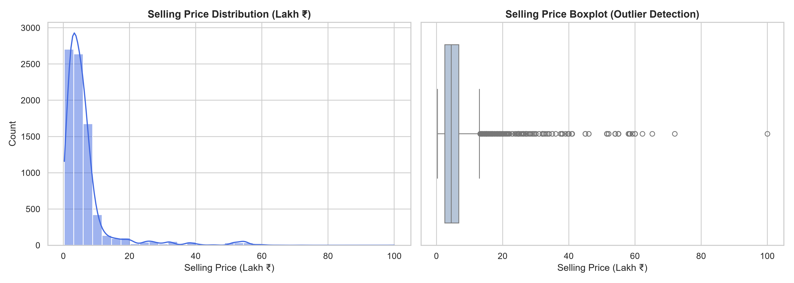
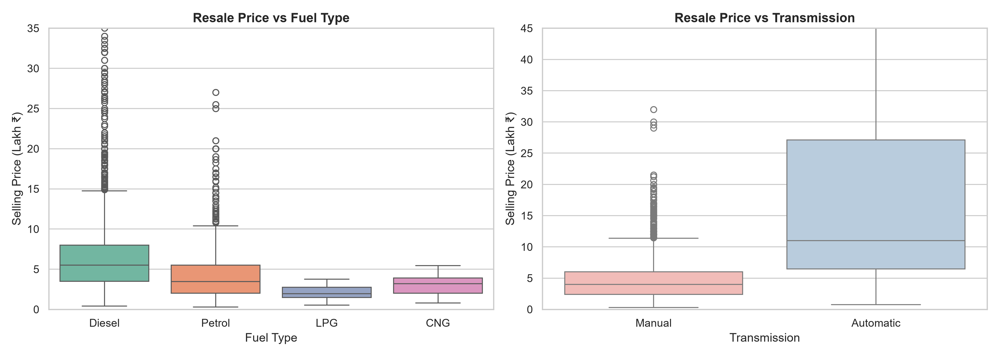
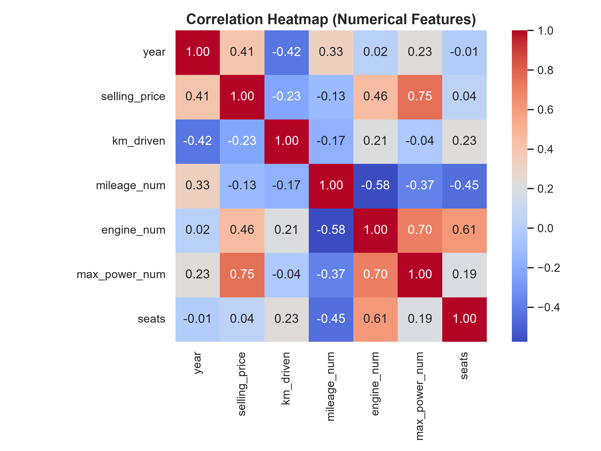
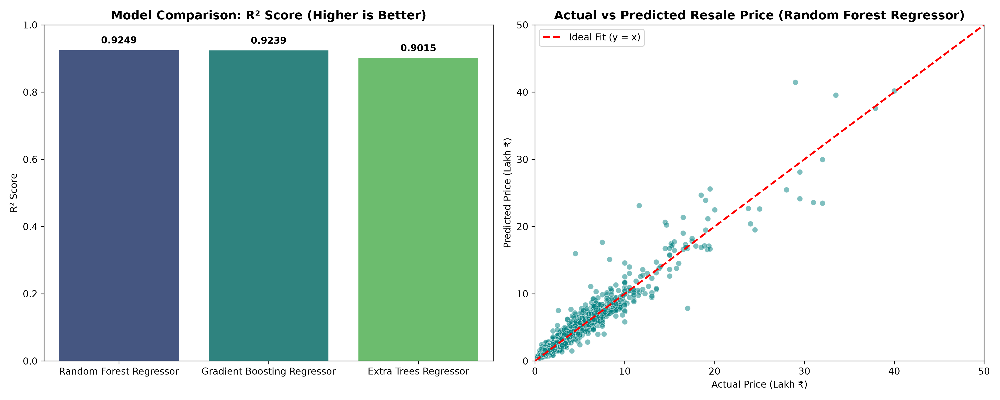

# 🚗 Used Car Resale Price Prediction Using Machine Learning Algorithms


An end-to-end Machine Learning capstone project that estimates the fair resale valuation of pre-owned vehicles based on technical specifications and historical market sales data from **CarDekho**.

The project implements, compares, and evaluates three tree-based ensemble algorithms: **Random Forest Regressor**, **Extra Trees Regressor**, and **Gradient Boosting Regressor**, deploying the top-performing model via an interactive **Streamlit web application**.

---

## 📌 Project Overview

Valuing a used automobile is an inherently complex challenge due to multi-factor non-linear depreciation: manufacturing age, cumulative mileage, brand prestige, fuel type, transmission mechanism, engine displacement, and historical ownership. 

This project solves this regression problem with a robust data preprocessing pipeline and ensemble learning algorithms, providing transparent valuation estimates along with confidence error bounds.

---

## 🏆 Model Performance Benchmark

All models were evaluated on the exact same **1,344 unseen testing vehicles** (20% holdout test set) with a fixed reproducible seed (`random_state=42`).

| Rank | Machine Learning Algorithm | Mean Absolute Error (MAE) | Root Mean Squared Error (RMSE) | $R^2$ Score | Training Time |
| :---: | :--- | :---: | :---: | :---: | :---: |
| 🥇 | **Random Forest Regressor** | **₹74,696.88** | **₹1,28,409.61** | **0.9249 (92.49%)** | 0.75 s |
| 🥈 | **Gradient Boosting Regressor** | ₹76,149.39 | ₹1,29,195.27 | **0.9239 (92.39%)** | 1.12 s |
| 🥉 | **Extra Trees Regressor** | ₹82,052.95 | ₹1,47,003.42 | **0.9015 (90.15%)** | 0.46 s |

> **Selected Deployment Model:** **Random Forest Regressor** achieved the lowest prediction error and the highest coefficient of determination ($R^2 = 92.49\%$). It is saved as a complete Scikit-Learn `Pipeline` in `models/best_car_price_model.joblib`.

---

## 📂 Project Structure

```text
Used-Car-Price-Prediction/
│
├── data/
│   ├── Car details v3.csv             # Raw Kaggle CarDekho dataset (8,128 records)
│   └── cleaned_car_data.csv           # Preprocessed dataset (6,717 high-quality records)
│
├── models/
│   ├── best_car_price_model.joblib    # Serialized Scikit-Learn Pipeline (Best Model)
│   ├── model_comparison.json          # Machine-readable performance benchmarks
│   └── model_metadata.json            # Model parameters, features, and UI options
│
├── notebooks/
│   ├── 01_exploratory_data_analysis.ipynb     # Jupyter Notebook for EDA & Data Hygiene
│   ├── 02_model_training_and_evaluation.ipynb # Jupyter Notebook for ML Modeling
│   ├── run_eda.py                             # Automated EDA execution script
│   └── eda_plots/                             # High-resolution plots for reports
│       ├── 01_selling_price_distribution.png
│       ├── 02_price_by_fuel_and_transmission.png
│       ├── 03_correlation_heatmap.png
│       ├── 04_top_car_brands.png
│       └── 05_model_performance_comparison.png
│
├── src/
│   ├── __init__.py                    # Python package marker
│   ├── preprocess.py                  # Regex unit stripping, deduplication, ColumnTransformer
│   └── train.py                       # Pipeline training, evaluation & artifact export
│
├── app.py                             # Interactive Streamlit Web Application
├── requirements.txt                   # Project dependencies
├── .gitignore                         # Git tracking rules
├── VIVA_GUIDE.md                      # College viva preparation notes & FAQs
└── README.md                          # Project documentation
```

---

## ⚙️ Data Preprocessing & Feature Engineering

The raw Kaggle dataset presents several real-world data quality issues that were systematically handled:

1. **Deduplication:** 1,202 exact duplicate records (14.79%) were identified and dropped to eliminate **data leakage** between the training and test sets.
2. **Feature Extraction:**
   - Extracted car manufacturer (`brand`) from the free-form `name` column.
   - Low-frequency brands (< 10 vehicles) are mapped to `'Other'` to prevent extreme sparsity.
3. **Unit Stripping with Regular Expressions:**
   - `mileage`: extracted numeric values from `"kmpl"` and `"km/kg"`.
   - `engine`: extracted numeric displacement from `"CC"`.
   - `max_power`: extracted numeric horsepower from `"bhp"` and handled non-numeric strings (e.g., bare `' bhp'`).
4. **Data Hygiene:**
   - 209 records missing all technical specifications were removed.
   - Physical anomalies (e.g., 0.0 kmpl mileage) were imputed with the median mileage.
5. **Leakage-Free Transformations:**
   - Features are encoded and scaled using a Scikit-Learn `ColumnTransformer` (`StandardScaler` for numeric columns, `OneHotEncoder(handle_unknown='ignore')` for categorical columns).

---

## 💻 Installation & Setup

### Prerequisites
- Python 3.9 to 3.13
- Git

### 1. Clone the Repository
```bash
git clone https://github.com/your-username/Used-Car-Price-Prediction.git
cd Used-Car-Price-Prediction
```

### 2. Create and Activate a Virtual Environment
```bash
# Windows
python -m venv venv
venv\Scripts\activate

# macOS / Linux
python3 -m venv venv
source venv/bin/activate
```

### 3. Install Dependencies
```bash
pip install -r requirements.txt
```

### 4. (Optional) Run Preprocessing & Training
The repository comes with the trained model already saved in `models/`. To retrain from scratch:
```bash
# Run EDA
python notebooks/run_eda.py

# Run Preprocessing & Training
python src/train.py
```

### 5. Launch the Streamlit Web Application
```bash
streamlit run app.py
```
Open your browser at `http://localhost:8501`.

---

## 📈 Exploratory Visualizations

| Target Distribution | Fuel & Transmission |
| :---: | :---: |
|  |  |

| Feature Correlation Heatmap | Model Benchmark & Actual vs Predicted |
| :---: | :---: |
|  |  |

---

## 🛠️ Technology Stack

- **Language:** Python 3.13
- **Data Wrangling:** Pandas, NumPy
- **Machine Learning:** Scikit-Learn (Random Forest, Extra Trees, Gradient Boosting, ColumnTransformer, Pipeline)
- **Model Serialization:** Joblib
- **Data Visualization:** Matplotlib, Seaborn
- **Web Frontend:** Streamlit

---

## 🎓 Academic Viva & Presentation Notes

Comprehensive viva questions, algorithmic trade-offs, and examiner FAQs are documented in **[VIVA_GUIDE.md](VIVA_GUIDE.md)**.
